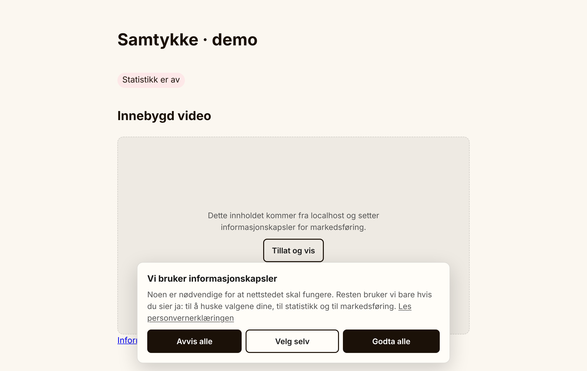

# Samtykke: cookie consent for Webflow

Ampers& house's own consent tool. One file of 8 KB (gzipped), no account, no monthly fee, no third-party server.
Works on any Webflow site, in Norwegian, English and Slovak.



## What it does

- **Blocks scripts and embeds until the visitor says yes.** Analytics, pixels, YouTube, maps.
- **Google Consent Mode v2.** Sets "denied" before GTM/gtag runs, updates when the visitor chooses.
- **Webflow Analyze / Optimize.** Calls Webflow's own `wf.allowUserTracking` / `wf.denyUserTracking`.
- **Withdrawal that actually works.** It deletes the category's cookies (`_ga`, `_fbp`, `_gcl_*`…) and reloads the page, because a script that's already running can't be stopped any other way.
- **Refusing is as easy as agreeing.** "Avvis alle" sits on the first layer with the same weight as "Godta alle". No switch is pre-ticked.
- **Accessible.** Native `<dialog>` with focus trap and Esc; the banner is first in reading order but doesn't steal focus; real checkboxes as switches; 44 px targets; forced colours. axe finds no WCAG 2.2 A/AA violations.
- **Remembers for 180 days**, and asks again when you raise `data-version` (new privacy policy).
- **Global Privacy Control** respected: with GPC on, "Godta alle" leaves marketing off.
- **Proof of consent (optional).** Sends each choice to your own endpoint: random ID, time, choices, page. No IP, no user agent.
- **Your own design.** Use the default UI and restyle it with CSS variables, or build the banner in the Designer and add attributes.

## Install on a Webflow site

**1. Site settings → Custom code → Head code**, at the very top, before anything from Google:

```html
<script src="https://cdn.jsdelivr.net/gh/legomedved/nottanrop@COMMIT/consent/dist/samtykke.min.js"
        data-policy="/personvern" data-version="1"></script>
```

No `defer`, no `async`: Consent Mode must be set before Google loads. Pin a commit hash instead of `@main`.

**2. Remove the Google Analytics ID from Webflow's built-in integration** (Site settings → Apps & integrations) and add
GA as a blocked script (step 3) or through GTM. *Inference, not tested on a live site:* Webflow may place its own
GA tag before your head code, so it would run before consent.

**3. Turn every tracking script into a blocked one.** Change `type` to `text/plain` and add the category:

```html
<script type="text/plain" data-samtykke="analytics" async src="https://www.googletagmanager.com/gtag/js?id=G-XXXX"></script>
<script type="text/plain" data-samtykke="analytics">
  window.dataLayer = window.dataLayer || []; function gtag(){dataLayer.push(arguments);}
  gtag('js', new Date()); gtag('config', 'G-XXXX');
</script>
```

Blocked scripts run in page order, and each external file finishes loading before the next script runs.
If you use **GTM**, load GTM normally (it respects Consent Mode) and trigger tags on the `samtykke_update` event,
or use GTM's built-in consent checks.

**4. Embeds** (Embed element, not Webflow's native YouTube element, which can't be blocked):

```html
<iframe data-samtykke="marketing" data-samtykke-src="https://www.youtube-nocookie.com/embed/VIDEO_ID"
        width="560" height="315" title="…" allow="fullscreen"></iframe>
```

A placeholder with "Tillat og vis" (Allow and show) appears until marketing is allowed.

**5. A way back.** Add `data-samtykke-action="open-preferences"` to a footer link ("Informasjonskapsler"),
or add `data-floating` to the script tag for a small floating button.

## Options (attributes on the script tag)

| Attribute | Default | What |
|---|---|---|
| `data-policy` | none | Link to the privacy policy |
| `data-version` | `1` | Raise it when the policy changes and everyone is asked again |
| `data-categories` | `preferences analytics marketing` | Which categories to show |
| `data-lang` | from `<html lang>` | `nb`, `en`, `sk` (`no`/`nn` → `nb`). Works with Webflow Localization |
| `data-expiry` | `180` | Days before asking again |
| `data-floating` | off | Floating reopen button |
| `data-position` | `center` | `left` puts the banner in the bottom-left corner |
| `data-ui` | `auto` | `none` = only your own Designer-built UI |
| `data-endpoint` | none | URL that receives consent records (POST, `text/plain` JSON) |
| `data-domain` | current host | e.g. `.example.no` to share consent across subdomains |
| `data-gpc="off"`, `data-consent-mode="off"`, `data-reload="off"` | on | Turn those features off |

Longer settings go in `window.SamtykkeConfig` before the script: `texts` (any wording), `cookies` (which cookies to delete per category).

## Design it in the Designer

```
data-samtykke-ui="banner"                    your banner (hidden until needed)
data-samtykke-ui="preferences"               your settings panel
data-samtykke-action="accept-all | reject-all | save | open-preferences | close"
data-samtykke-toggle="analytics"             on a Webflow form checkbox
data-samtykke-if="analytics"                 element shown only with consent
data-samtykke-unless="marketing"             element shown only without
```

Link blocks and divs work as buttons. Webflow form checkboxes stay in sync (including the custom checkbox style),
and the form's submit button saves instead of posting to Webflow. Restyle the default UI instead with
`--smk-bg`, `--smk-ink`, `--smk-muted`, `--smk-line`, `--smk-accent`, `--smk-on-accent`, `--smk-focus`, `--smk-radius`, `--smk-font`.

## JavaScript

```js
Samtykke.has("analytics")          // true / false
Samtykke.get()                     // { decided, id, version, timestamp, categories }
Samtykke.open()                    // settings
Samtykke.on(state => …)            // or window.addEventListener("samtykke:change", e => e.detail)
Samtykke.reset()                   // forget, show the banner again (testing)
```

## What the paid tools do that this doesn't (yet)

Be honest with clients about these:

| | Samtykke | Consent Pro / Cookiebot class |
|---|---|---|
| Cookie **scanner** that finds and categorises trackers | ✗ You list scripts by hand | ✓ |
| **Automatic** blocking of scripts nobody tagged | ✗ | ✓ (partly) |
| Hosted **consent log** with dashboard | Your own endpoint | ✓ |
| **Geo-targeting** (banner only in EU/EEA) | ✗ Same banner for everyone | ✓ (premium) |
| **IAB TCF v2.2** / **Google-certified CMP** | ✗ | ✓ |
| Generated cookie declaration / privacy policy | ✗ | ✓ |

The last-but-one row matters only for sites that **show Google ads** (AdSense, Ad Manager, AdMob) in the EEA:
Google requires a certified CMP for those. Analytics, GTM, Meta pixel and Google Ads *conversion tracking* work with Consent Mode, as here.

This is a tool, not legal advice. The legal checklist per client: a privacy policy that names the cookies,
every tracking script tagged, and a test in a private window that nothing loads before consent.

## Develop

```bash
npm run build:samtykke                 # → consent/dist/samtykke.min.js
node consent/test/samtykke.test.js     # 43 checks in Chromium: blocking, order, Consent Mode, withdrawal, GPC, custom UI, axe
```

Demo pages: `consent/demo/index.html` (default UI) and `consent/demo/custom.html` (Designer-style UI). Serve them over http, not file://.
